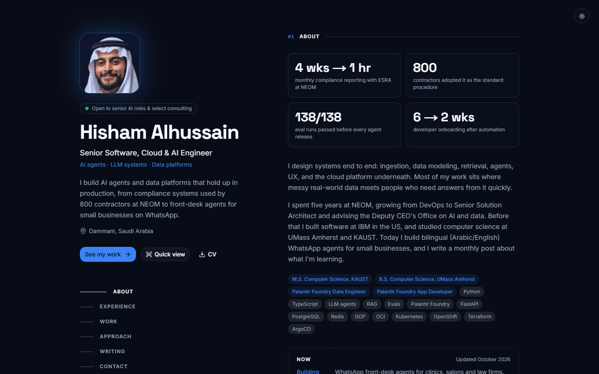

# hisham-alhussain.dev

The source for my personal site: portfolio, case studies, and a monthly blog on AI
agents and LLM engineering. It is live at
**[hisham-alhussain.dev](https://www.hisham-alhussain.dev)**.



| | |
|---|---|
| **Framework** | Next.js 15 (App Router), React 19, TypeScript |
| **Styling** | Tailwind CSS with shadcn/ui primitives, Inter + Space Grotesk via `next/font` |
| **Content** | Typed TypeScript content files; no CMS and no database |
| **Rendering** | Static pages at build time; GitHub data revalidated daily |
| **Hosting** | Vercel, deployed from `main`, with a preview build for every branch |

---

## What's on the site

- **Profile and proof.** A sticky profile column with my headshot, availability
  and section navigation, next to headline results (ESRA's 4-week-to-1-hour
  reporting, the 138/138 eval gate) instead of a list of adjectives.
- **Experience timeline.** Dated roles from IBM through NEOM and EPAM, each
  with measured outcomes.
- **Case studies.** One page per major project (`/work/[slug]`) covering the
  problem, what I built, the outcome and an architecture diagram. Internal NEOM
  work is described at a high level without confidential data.
- **How I work.** Four working principles, each backed by a specific result.
- **Writing.** A post on the 1st of every month (`/blog/[slug]`), with reading
  times and an RSS feed at `/feed.xml`.
- **Two contact routes.** One for hiring (with a CV download) and one for
  businesses that want a WhatsApp AI agent.
- **Quick view.** A one-screen summary for recruiters, opened from the profile
  column or the mobile menu.

## Design and engineering decisions

**Content lives in data, not in components.** Everything a visitor reads is in
[`src/content/`](src/content/): profile, experience and principles in
`site.ts`, projects and case studies in `projects.ts`, and blog posts in
`posts.ts` and `post-bodies.ts`. Updating the site means editing a typed object,
and TypeScript catches a missing field before the build does.

**Server components by default.** The homepage is a server component. Only the
pieces that need the browser are client components: section tracking, the
mobile menu, the quick view dialog and the theme toggle. Post bodies are kept
out of the client bundle entirely.

**No loading states for visitors.** The open source list is fetched from the
GitHub API at build time and revalidated daily, with static fallbacks if the
API is unavailable. A visitor never sees a spinner or an error card.

**Motion that never hides content.** Sections fade in with CSS scroll-driven
animations rather than JavaScript. Browsers without support, visitors with
reduced motion turned on, and crawlers all get the content immediately.

**Small, dependency-free pieces where they're enough.** Blog and case-study
text uses a minimal markdown renderer (headings, lists, quotes, bold, italics,
code and links) instead of a full MDX pipeline. Architecture diagrams are plain
HTML and CSS, so they follow the light and dark themes automatically.

**SEO and sharing.** Per-page metadata and canonical URLs, Open Graph images
generated at `/api/og`, `sitemap.xml`, `robots.txt`, and `Person` JSON-LD.

I used Claude Code as a coding assistant to speed up implementation.

## Repository tour

| Path | What's there |
|---|---|
| [`src/app/page.tsx`](src/app/page.tsx) | homepage: profile column, about, experience, work, approach, writing, contact |
| [`src/app/work/[slug]/`](src/app/work/) | case-study pages |
| [`src/app/blog/`](src/app/blog/) | blog index and post pages |
| [`src/app/api/og/`](src/app/api/og/), [`feed.xml/`](src/app/feed.xml/), [`sitemap.ts`](src/app/sitemap.ts) | social images, RSS, sitemap |
| [`src/content/`](src/content/) | all site copy: profile, experience, projects, case studies, posts |
| [`src/components/site/`](src/components/site/) | section navigation, mobile header, quick view, flow diagrams, GitHub highlights |
| [`src/components/blog/`](src/components/blog/) | markdown renderer for posts and case studies |
| [`src/components/ui/`](src/components/ui/) | shadcn/ui primitives and the theme toggle |
| [`public/`](public/) | headshot, CV PDF, icons and the default social image |

## Running it locally

Requires Node.js 18 or later.

```sh
git clone https://github.com/hisham8383/hisham-portfolio.git
cd hisham-portfolio
npm install
npm run dev        # http://localhost:3000
```

| Task | Command |
|---|---|
| Dev server (Turbopack) | `npm run dev` |
| Production build | `npm run build` |
| Serve the production build | `npm run start` |
| Lint | `npm run lint` |
| Type check | `npx tsc --noEmit` |

## Updating content

| To change | Edit |
|---|---|
| Headline, stats, about, experience, "Now" | `src/content/site.ts` |
| Projects and case studies | `src/content/projects.ts` |
| A new blog post | add metadata to `src/content/posts.ts` and the body to `src/content/post-bodies.ts` |
| The CV download | replace `public/Hisham-Alhussain-CV.pdf` |

Pushing to `main` deploys to production.

---

Built by **Hisham Alhussain**. The code is public so you can see how it's put
together; please don't redeploy it as your own site.
